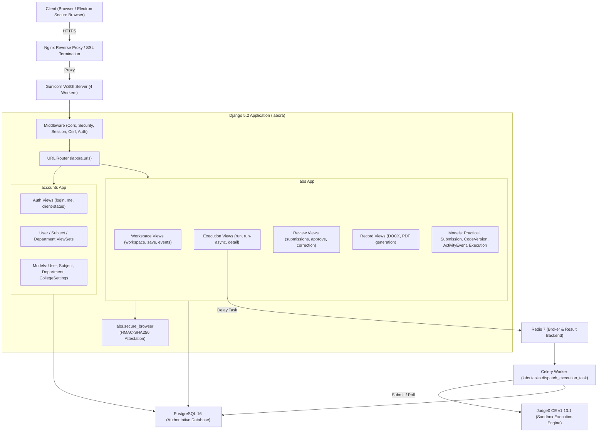

# LABORA — Backend Technical Audit & Architecture

**Inspection Scope:** Complete Django backend implementation in `server/backend/`  
**Django Version:** `5.2.19` (requirement: `Django>=5.0,<6.0`)  
**Python Runtime:** Python `3.11.9` (compatible with Python 3.10+)  

---

## 1. Backend Architecture Overview

The LABORA backend is built with Django and Django REST Framework (DRF), following a decoupled, API-first architecture designed to serve both the browser-based single-page application and the Electron Secure Browser.

---

## 2. Dependencies & Package Analysis

From `server/backend/requirements.txt` (production) and `server/backend/requirements-test.txt` (local Windows test):

| Package | Version Specifier | Production Role | Windows Test Kit Note |
|---|---|---|---|
| `Django` | `>=5.0,<6.0` | Core Web & ORM Framework | Installed: `5.2.19` |
| `djangorestframework` | `>=3.15` | RESTful API Layer & Serializers | Installed: `3.15.2` |
| `djangorestframework-simplejwt` | `>=5.3` | Stateless JWT Authentication | Installed: `5.3.1` |
| `django-cors-headers` | `>=4.3` | Cross-Origin Resource Sharing | Installed: `4.3.1` |
| `psycopg[binary]` | `>=3.1` | PostgreSQL Database Adapter | Omitted in Windows test kit (uses SQLite) |
| `gunicorn` | `>=22` | Production WSGI HTTP Server | Omitted in Windows test kit (uses `runserver`) |
| `weasyprint` | `>=62` | Headless HTML/CSS to PDF Engine | Omitted in Windows test kit (needs GTK) |
| `python-docx` | `>=1.1` | Word Document (.docx) Generator | Installed: `1.1.2` |
| `requests` | `>=2.31` | HTTP Client for Judge0 & AI APIs | Installed: `2.31.0` |
| `Pillow` | `>=10` | Image processing for College Logo | Installed: `10.4.0` |
| `celery` | `>=5.3` | Asynchronous Background Task Queue | Installed: `5.3.6` |
| `redis` | `>=5.0` | Redis client and Celery Broker | Installed: `5.0.4` |
| `packaging` | `>=23` | Version string comparison | Installed: `24.0` |

---

## 3. Django Settings & Configuration Audit

Located in [server/backend/labora/settings.py](file:///d:/v/LABORA-Test-Windows/server/backend/labora/settings.py).

### Key Architectural Configurations:
1. **Dynamic Environment Variable Parsing:**
   - Evaluates `.env` file at `server/backend/.env` if present.
   - Helper functions: `env()`, `env_bool()`, `env_list()`.
2. **Database Engine Switch:**
   - If `POSTGRES_DB` is set, switches to `django.db.backends.postgresql` connecting to `POSTGRES_HOST:POSTGRES_PORT`.
   - Defaults to `django.db.backends.sqlite3` (`BASE_DIR / db.sqlite3`) for zero-dependency local testing.
3. **Authentication & JWT Lifetimes:**
   - Custom user model: `AUTH_USER_MODEL = "accounts.User"`.
   - SimpleJWT lifetimes: Access token: 60 minutes (`JWT_ACCESS_MINUTES`), Refresh token: 12 hours (`JWT_REFRESH_HOURS`).
4. **Rate Limiting (Throttling):**
   - User throttle rate: `600/min`.
   - Code execution rate: `20/min` (`RUN_RATE`).
   - Login rate: `20/min` (`LoginThrottle` in `accounts/views.py`).
5. **CORS Headers:**
   - `CORS_ALLOWED_ORIGINS` defaults to `http://localhost:5173,http://127.0.0.1:5173`.
   - Explicitly allows Secure Browser headers: `x-labora-ts`, `x-labora-signature`, `x-labora-client`.
6. **Celery & Task Broker Settings:**
   - `CELERY_BROKER_URL`: Defaults to `redis://localhost:6379/0`.
   - `CELERY_RESULT_BACKEND`: Defaults to `redis://localhost:6379/1`.
   - `CELERY_TASK_ALWAYS_EAGER`: Set to `False` by default (overridden to `True` in test suite).
   - `CELERY_TASK_TIME_LIMIT`: 120s; `CELERY_TASK_SOFT_TIME_LIMIT`: 90s.
7. **Secure Browser HMAC Settings:**
   - `SECURE_BROWSER_KEY`: Defaults to `"change-this-shared-browser-key"`.
   - `SECURE_BROWSER_MAX_SKEW_SECONDS`: Maximum clock drift allowance of 300 seconds (5 minutes).
8. **Static & SPA Delivery:**
   - `FRONTEND_DIST` points to `server/frontend/dist`. When `index.html` exists, Django serves compiled SPA assets directly via `re_path` for single-server test environments.

---

## 4. Application Modules & Relationships

### 4.1 Accounts Application (`accounts`)
- **Purpose:** Manages organizational structure, identity, role-based authorization, and institutional configuration.
- **Key Models:**
  - `Department`: Contains academic departments (e.g., MCA, CSE).
  - `User`: Custom user with roles: `admin`, `teacher`, `student`. Roll numbers and batches are stored for students.
  - `Subject`: Course definition associated with a department, many-to-many links to enrolled students and teaching teachers.
  - `CollegeSettings`: Singleton record storing college name, logo, lab record headers, and the global `students_secure_browser_only` flag.
- **Key Features:**
  - Bulk student onboarding via CSV upload (`UserViewSet.import_csv`).
  - Batch student enrollment into subjects by username/roll number (`SubjectViewSet.enroll`).
  - Pre-login Secure Browser gate for students (`accounts.views.login`).

### 4.2 Labs Application (`labs`)
- **Purpose:** Core educational engine managing programming assignments, workspace sessions, code execution, telemetry, teacher reviews, and official lab record generation.
- **Key Models:**
  - `Practical`: Assignment specifications (problem statement, aim, language [C, Java, Python], starter code, sample input, restriction flags).
  - `Submission`: Student work tracking status (`in_progress`, `submitted`, `correction`, `approved`), teacher notes, and pointer to the verified `record_execution`.
  - `CodeVersion`: Linear revision history saved on autosave, execution, or submission.
  - `ActivityEvent`: Immutable telemetry log tracking typing cadence, paste blocks, window blurs, and kiosk alerts.
  - `Execution`: State machine and output container for student code executions.
- **Key Subsystems:**
  - `executor.py`: Low-level synchronous runner (Judge0 CE or local host subprocess).
  - `tasks.py`: Asynchronous Celery worker task dispatching and polling Judge0.
  - `secure_browser.py`: Cryptographic HMAC-SHA256 signature verification.
  - `indicators.py`: Rule-based academic integrity indicator engine.
  - `records.py`: Automated DOCX and WeasyPrint PDF laboratory record generator.
  - `ai_review.py`: LLM-assisted code structure summarizer for teachers.

---

## 5. Middleware, Signals & Background Tasks

### Middleware Pipeline:
1. `corsheaders.middleware.CorsMiddleware`: Injects CORS headers for allowed origins.
2. `django.middleware.security.SecurityMiddleware`: Basic HTTP security headers.
3. `django.contrib.sessions.middleware.SessionMiddleware`: Session handling for Django Admin.
4. `django.middleware.common.CommonMiddleware`: URL normalization.
5. `django.middleware.csrf.CsrfViewMiddleware`: CSRF protection for session-authenticated views.
6. `django.contrib.auth.middleware.AuthenticationMiddleware`: Binds `request.user`.
7. `django.contrib.messages.middleware.MessageMiddleware`: Flash message support.
8. `django.middleware.clickjacking.XFrameOptionsMiddleware`: DENY / SAMEORIGIN frame protection.

### Background Tasks:
- Task: `labs.tasks.dispatch_execution_task`
  - Registered via Celery `@shared_task(bind=True, max_retries=3, default_retry_delay=3)`.
  - Triggered by: `POST /api/workspace/<id>/run-async/`.
  - Responsibility: Transitions `Execution` state (`DISPATCHING` -> `PROCESSING` -> `COMPLETED`/`FAILED`/`TIMED_OUT`), posts job to Judge0 API, polls for output, records run metrics, and logs an `ActivityEvent(kind='run')`.

---

## 6. Complete API Endpoint Inventory

The following table documents every registered endpoint in `server/backend/labora/urls.py`:

| HTTP Method | URL Path | View Function / Class | Permission Class | Input Body / Query Parameters | Response Structure / Output | Functional Purpose | Audit Verification Status |
|---|---|---|---|---|---|---|---|
| `POST` | `/api/auth/login/` | `accounts.views.login` | `AllowAny` (Throttled: 20/min) | `{"username": "...", "password": "..."}` | `{"access": "JWT", "refresh": "JWT", "user": {...}}` | Authenticates user; validates Secure Browser if student gate active | **Verified** (Tested in test suite) |
| `POST` | `/api/auth/refresh/` | `TokenRefreshView` | `AllowAny` | `{"refresh": "JWT"}` | `{"access": "JWT"}` | Refreshes expired JWT access token | **Verified** (SimpleJWT built-in) |
| `GET` | `/api/auth/me/` | `accounts.views.me` | `IsAuthenticated` | None | `{"id": int, "username": str, "full_name": str, "role": str, ...}` | Returns active user profile | **Verified** |
| `GET` | `/api/client-status/` | `accounts.views.client_status` | `AllowAny` | Headers: `X-Labora-Ts`, `X-Labora-Signature` | `{"secure_browser": bool, "college_name": str}` | UI health check confirming if server detects Secure Browser signature | **Verified** |
| `GET` | `/api/college-settings/` | `accounts.views.college_settings` | `IsAuthenticated` | None | `{"college_name": str, "college_address": str, "logo": url, ...}` | Retrieves institutional branding and browser gate status | **Verified** |
| `PUT/PATCH`| `/api/college-settings/` | `accounts.views.college_settings` | `IsAdminRole` | Settings fields: `college_name`, `record_title`, etc. | Updated settings JSON | Updates institutional branding | **Verified** |
| `GET` | `/api/departments/` | `accounts.DepartmentViewSet` | `ReadOnlyOrAdmin` | None | `[{"id": int, "name": str, "code": str}]` | Lists academic departments | **Verified** |
| `POST` | `/api/departments/` | `accounts.DepartmentViewSet` | `IsAdminRole` | `{"name": str, "code": str}` | Created department object | Creates a department | **Verified** |
| `GET` | `/api/subjects/` | `accounts.SubjectViewSet` | `ReadOnlyOrAdmin` | Filter by role (Teacher: assigned; Student: enrolled) | `[{"id": int, "name": str, "code": str, ...}]` | Lists accessible subjects | **Verified** |
| `POST` | `/api/subjects/<id>/enroll/` | `SubjectViewSet.enroll` | `IsAdminRole` | `{"students": ["MCA001", "student1"]}` | `{"enrolled": int, "not_found": [...]}` | Bulk enrolls students into course by username or roll no | **Verified** |
| `GET` | `/api/users/` | `accounts.UserViewSet` | `IsAdminRole` | Query: `?role=student` | `[{"id": int, "username": str, "role": str, ...}]` | Lists users (admin dashboard) | **Verified** |
| `POST` | `/api/users/import/` | `UserViewSet.import_csv` | `IsAdminRole` | Multipart form: `file` (CSV file) | `{"created": int, "errors": [...]}` | Bulk creates user accounts from CSV | **Verified** |
| `GET` | `/api/practicals/` | `labs.PracticalViewSet` | `IsAuthenticated` | Query: `?subject=id` | Practical list (Student: hides question; Teacher: full) | Lists practicals for enrolled subject | **Verified** |
| `POST` | `/api/practicals/` | `labs.PracticalViewSet` | `IsTeacherOrAdmin` | `{"subject": id, "experiment_no": int, "title": str, ...}` | Created practical object | Creates a new practical problem statement | **Verified** |
| `GET` | `/api/practicals/<id>/` | `labs.PracticalViewSet` | `IsAuthenticated` | None | Practical detail | Retrieves practical details (question stripped for students) | **Verified** |
| `GET` | `/api/practicals/<id>/submissions/` | `PracticalViewSet.submissions`| `IsTeacherOrAdmin` | None | `{"practical": {...}, "rows": [{"student_id": int, "status": str, "runs": int, "indicators": [...]}]}` | Teacher monitoring dashboard table of all students | **Verified** |
| `GET` | `/api/workspace/<id>/` | `labs.views.workspace` | `IsStudent` | Headers: `X-Labora-Signature` (if required) | `{"practical": {...}, "submission": {...}, "last_execution": {...}, "secure_browser": bool}` | Student workspace initialization and session start logging | **Verified** |
| `POST` | `/api/workspace/<id>/save/` | `labs.views.workspace_save` | `IsStudent` | `{"code": str}` | `{"saved_at": iso, "version": int}` | Autosaves student code draft and creates `CodeVersion` | **Verified** |
| `POST` | `/api/workspace/<id>/run/` | `labs.views.workspace_run` | `IsStudent` (Throttled: 20/min) | `{"code": str, "stdin": str}` | `{"id": int, "status": str, "stdout": str, "stderr": str, ...}` | Synchronous code execution (blocks until complete) | **Verified** |
| `POST` | `/api/workspace/<id>/run-async/` | `labs.views.workspace_run_async`| `IsStudent` (Throttled: 20/min) | `{"code": str, "stdin": str}` | `{"execution_id": int, "state": "QUEUED", "poll_url": str}` | Enqueues background Celery task; returns HTTP 202 | **Verified** |
| `GET` | `/api/workspace/<id>/executions/<pk>/`| `labs.views.execution_detail` | `IsAuthenticated` | None | Execution status, state, stdout, stderr, compile_output | Isolated status polling for workspace executions | **Verified** |
| `GET` | `/api/executions/<pk>/` | `labs.views.execution_detail` | `IsAuthenticated` | None | Execution status, state, stdout, stderr, compile_output | Root execution detail polling endpoint | **Verified** |
| `POST` | `/api/workspace/<id>/events/` | `labs.views.workspace_events` | `IsStudent` | `{"events": [{"kind": str, "chars": int, "t": ms, "detail": {}}]}` | `{"stored": int}` | Batch ingestion of client typing and security telemetry | **Verified** |
| `POST` | `/api/workspace/<id>/submit/` | `labs.views.workspace_submit` | `IsStudent` | `{"code": str}` | Full workspace payload with `status="submitted"` | Final submission; validates match against accepted run | **Verified** |
| `GET` | `/api/submissions/<pk>/` | `labs.views.submission_detail` | `IsTeacherOrAdmin` | None | `{"submission": {...}, "versions": [...], "events": [...], "executions": [...], "indicators": [...]}` | Full teacher review dossier for grading | **Verified** |
| `POST` | `/api/submissions/<pk>/approve/`| `labs.views.submission_approve`| `IsTeacherOrAdmin` | `{"execution_id": int, "result": str, "note": str}` | Updated submission object (`status="approved"`) | Approves practical for inclusion in lab record | **Verified** |
| `POST` | `/api/submissions/<pk>/request-correction/`| `labs.views.submission_request_correction`| `IsTeacherOrAdmin` | `{"note": str}` | Updated submission object (`status="correction"`) | Unlocks submission and returns to student for rework | **Verified** |
| `POST` | `/api/submissions/<pk>/ai-summary/`| `labs.views.submission_ai_summary`| `IsTeacherOrAdmin` | None | `{"summary": str, "note": str}` | Generates LLM summary of program structure and indicators | Implemented (Requires API Key) |
| `GET` | `/api/records/` | `labs.views.record_overview` | `IsAuthenticated` (Student) | None | `[{"subject": {...}, "total": int, "approved": [...]}]` | Lists approved practicals eligible for record export | **Verified** |
| `GET` | `/api/records/subject/<id>/` | `labs.views.record_subject` | `IsAuthenticated` | Query: `?type=docx` or `?type=pdf` | Binary file download (`.docx` or `.pdf`) | Full subject laboratory record file export | **Verified** |
| `GET` | `/api/records/submission/<pk>/`| `labs.views.record_single` | `IsAuthenticated` | Query: `?type=docx` or `?type=pdf` | Binary file download (`.docx` or `.pdf`) | Single experiment record export | **Verified** |
| `GET` | `/api/reports/subject/<id>/` | `labs.views.subject_report` | `IsTeacherOrAdmin` | None | `{"subject": {...}, "rows": [{"experiment_no": int, "students": int, "submitted": int, ...}]}` | Aggregated progress and anomaly report across practicals | **Verified** |
