# LABORA — Database Schema & Architecture Audit

**Authoritative Engines:** PostgreSQL 16 (Production) / SQLite 3.x (Development Test Kit)  
**ORM Framework:** Django 5.2 ORM (`django.db.models`)  
**Migrations Baseline:** `accounts.0001_initial`, `labs.0001_initial`, `labs.0002_execution_completed_at_execution_judge0_token_and_more`  

---

## 1. Database Entity-Relationship (ER) Diagram

```mermaid
erDiagram
    Department ||--o{ User : "belongs to"
    Department ||--o{ Subject : "hosts"
    
    User ||--o{ Subject : "teaches (M2M)"
    User ||--o{ Subject : "enrolled in (M2M)"
    User ||--o{ Practical : "creates (created_by)"
    User ||--o{ Submission : "authors (student)"
    User ||--o{ Submission : "approves (approved_by)"
    
    Subject ||--o{ Practical : "contains"
    
    Practical ||--o{ Submission : "has"
    
    Submission ||--o{ CodeVersion : "tracks"
    Submission ||--o{ ActivityEvent : "logs"
    Submission ||--o{ Execution : "executes"
    Submission |o--o| Execution : "locks output via (record_execution)"

    CollegeSettings {
        bigint id PK
        varchar college_name
        varchar college_address
        varchar logo
        varchar record_title
        varchar record_footer
        boolean students_secure_browser_only
    }

    Department {
        bigint id PK
        varchar name UK
        varchar code UK
    }

    User {
        bigint id PK
        varchar username UK
        varchar password
        varchar first_name
        varchar last_name
        varchar email
        varchar role
        varchar roll_no
        smallint semester
        varchar batch
        bigint department_id FK
        boolean is_active
        datetime date_joined
    }

    Subject {
        bigint id PK
        varchar name
        varchar code
        smallint semester
        varchar academic_year
        bigint department_id FK
    }

    Practical {
        bigint id PK
        bigint subject_id FK
        integer experiment_no
        varchar title
        text aim
        text question
        varchar language
        text starter_code
        text sample_input
        boolean restricted
        boolean require_secure_browser
        boolean is_published
        datetime due_date
        datetime created_at
        bigint created_by_id FK
    }

    Submission {
        bigint id PK
        bigint practical_id FK
        bigint student_id FK
        text code
        varchar status
        text result
        text teacher_note
        datetime started_at
        datetime updated_at
        datetime submitted_at
        datetime approved_at
        bigint approved_by_id FK
        bigint record_execution_id FK
    }

    CodeVersion {
        bigint id PK
        bigint submission_id FK
        integer number
        text code
        varchar reason
        datetime created_at
    }

    ActivityEvent {
        bigint id PK
        bigint submission_id FK
        varchar kind
        integer chars
        jsonb detail
        datetime client_time
        datetime created_at
        boolean secure_browser
    }

    Execution {
        bigint id PK
        bigint submission_id FK
        text code
        text stdin
        text stdout
        text stderr
        text compile_output
        varchar state
        varchar status
        varchar time
        integer memory
        varchar judge0_token
        varchar runner_url
        text last_error
        smallint retry_count
        datetime started_at
        datetime completed_at
        datetime created_at
    }
```



---

## 2. Table-by-Table Architectural Specification

### 2.1 `accounts_collegesettings`
- **Purpose:** Singleton configuration table storing institutional branding, PDF/DOCX templates, and the Secure Browser login gate.
- **Enforcement:** Overridden `save()` forces `self.pk = 1`. `load()` classmethod gets or creates `pk=1`.
- **Fields:**
  - `id`: BigAutoField (PK)
  - `college_name`: `CharField(max_length=200, default="Your College Name")`
  - `college_address`: `CharField(max_length=300, blank=True)`
  - `logo`: `ImageField(upload_to="logo/", null=True, blank=True)`
  - `record_title`: `CharField(max_length=120, default="LABORATORY RECORD")`
  - `record_footer`: `CharField(max_length=200, default="Certified bonafide record of work done by the student.")`
  - `students_secure_browser_only`: `BooleanField(default=False)`

### 2.2 `accounts_department`
- **Purpose:** Academic departments (e.g., Computer Science, Information Technology).
- **Fields:**
  - `id`: BigAutoField (PK)
  - `name`: `CharField(max_length=120, unique=True)`
  - `code`: `CharField(max_length=20, unique=True)`
- **Ordering:** `["name"]`

### 2.3 `accounts_user`
- **Purpose:** Extends Django's `AbstractUser` with academic hierarchy fields.
- **Fields:**
  - `id`: BigAutoField (PK)
  - Standard Django user fields: `username` (UK), `password`, `first_name`, `last_name`, `email`, `is_active`, `is_staff`, `is_superuser`, `date_joined`, `last_login`.
  - `role`: `CharField(max_length=10, choices=[('admin', 'Admin'), ('teacher', 'Teacher'), ('student', 'Student')], default='student')`
  - `department_id`: `ForeignKey(Department, on_delete=SET_NULL, null=True, blank=True)`
  - `roll_no`: `CharField(max_length=40, blank=True)` (Student roll number)
  - `semester`: `PositiveSmallIntegerField(null=True, blank=True)`
  - `batch`: `CharField(max_length=40, blank=True)` (e.g., "2025-27")
- **Properties:** `is_admin_role`, `is_teacher`, `is_student`.

### 2.4 `accounts_subject`
- **Purpose:** Academic courses containing practical examinations.
- **Fields:**
  - `id`: BigAutoField (PK)
  - `name`: `CharField(max_length=150)`
  - `code`: `CharField(max_length=30)`
  - `semester`: `PositiveSmallIntegerField(default=1)`
  - `academic_year`: `CharField(max_length=20, blank=True)` (e.g., "2026-27")
  - `department_id`: `ForeignKey(Department, on_delete=CASCADE, related_name="subjects")`
- **Relationships (M2M Tables):**
  - `accounts_subject_teachers`: `ManyToManyField(User, limit_choices_to={"role": "teacher"})`
  - `accounts_subject_students`: `ManyToManyField(User, limit_choices_to={"role": "student"})`
- **Constraints:** `unique_together = [("code", "academic_year")]`

### 2.5 `labs_practical`
- **Purpose:** Laboratory assignment problem statement and execution parameters.
- **Fields:**
  - `id`: BigAutoField (PK)
  - `subject_id`: `ForeignKey(Subject, on_delete=CASCADE, related_name="practicals")`
  - `experiment_no`: `PositiveIntegerField()`
  - `title`: `CharField(max_length=200)`
  - `aim`: `TextField()` (Printed in formal lab record)
  - `question`: `TextField()` (Displayed in workspace)
  - `language`: `CharField(max_length=10, choices=[('c', 'C'), ('java', 'Java'), ('python', 'Python')])`
  - `starter_code`: `TextField(blank=True)`
  - `sample_input`: `TextField(blank=True)`
  - `restricted`: `BooleanField(default=True)` (Blocks external paste/drag-drop)
  - `require_secure_browser`: `BooleanField(default=True)` (Enforces HMAC attestation)
  - `is_published`: `BooleanField(default=True)`
  - `due_date`: `DateTimeField(null=True, blank=True)`
  - `created_by_id`: `ForeignKey(User, null=True, on_delete=SET_NULL)`
  - `created_at`: `DateTimeField(auto_now_add=True)`
- **Constraints:** `unique_together = [("subject", "experiment_no")]`

### 2.6 `labs_submission`
- **Purpose:** Tracks an individual student's progress and authoritative grading record for a practical.
- **Fields:**
  - `id`: BigAutoField (PK)
  - `practical_id`: `ForeignKey(Practical, on_delete=CASCADE, related_name="submissions")`
  - `student_id`: `ForeignKey(User, on_delete=CASCADE, related_name="submissions")`
  - `code`: `TextField(blank=True)` (Latest saved code)
  - `status`: `CharField(max_length=20, choices=[('in_progress', 'In progress'), ('submitted', 'Submitted'), ('correction', 'Correction requested'), ('approved', 'Approved')], default='in_progress')`
  - `result`: `TextField(blank=True)` (Printed on lab certificate)
  - `teacher_note`: `TextField(blank=True)` (Feedback from teacher)
  - `started_at`: `DateTimeField(auto_now_add=True)`
  - `updated_at`: `DateTimeField(auto_now=True)`
  - `submitted_at`: `DateTimeField(null=True, blank=True)`
  - `approved_at`: `DateTimeField(null=True, blank=True)`
  - `approved_by_id`: `ForeignKey(User, null=True, blank=True, on_delete=SET_NULL)`
  - `record_execution_id`: `ForeignKey(Execution, null=True, blank=True, on_delete=SET_NULL, related_name="+")`
- **Constraints:** `unique_together = [("practical", "student")]`
- **Properties:** `is_locked`: True when status is `submitted` or `approved`.

### 2.7 `labs_codeversion`
- **Purpose:** Linear historical revisions of student code snapshots.
- **Fields:**
  - `id`: BigAutoField (PK)
  - `submission_id`: `ForeignKey(Submission, on_delete=CASCADE, related_name="versions")`
  - `number`: `PositiveIntegerField()` (1, 2, 3...)
  - `code`: `TextField()`
  - `reason`: `CharField(max_length=10, choices=[('autosave', 'Autosave'), ('run', 'Run'), ('submit', 'Submit')])`
  - `created_at`: `DateTimeField(auto_now_add=True)`
- **Constraints:** `unique_together = [("submission", "number")]`

### 2.8 `labs_activityevent`
- **Purpose:** Immutable audit log of student interaction telemetry during exam.
- **Fields:**
  - `id`: BigAutoField (PK)
  - `submission_id`: `ForeignKey(Submission, on_delete=CASCADE, related_name="events")`
  - `kind`: `CharField(max_length=20, choices=[('session_start', ...), ('insert', ...), ('delete', ...), ('internal_paste', ...), ('paste_blocked', ...), ('drop_blocked', ...), ('focus_lost', ...), ('focus_back', ...), ('fullscreen_exit', ...), ('secure_alert', ...), ('run', ...), ('submit', ...)])`
  - `chars`: `IntegerField(default=0)`
  - `detail`: `JSONField(default=dict, blank=True)`
  - `client_time`: `DateTimeField(null=True, blank=True)`
  - `created_at`: `DateTimeField(auto_now_add=True)`
  - `secure_browser`: `BooleanField(default=False)`

### 2.9 `labs_execution`
- **Purpose:** Execution state machine, outputs, performance metrics, and sandbox runner tokens.
- **Fields:**
  - `id`: BigAutoField (PK)
  - `submission_id`: `ForeignKey(Submission, on_delete=CASCADE, related_name="executions")`
  - `code`: `TextField()`
  - `stdin`: `TextField(blank=True)`
  - `stdout`: `TextField(blank=True)`
  - `stderr`: `TextField(blank=True)`
  - `compile_output`: `TextField(blank=True)`
  - `state`: `CharField(max_length=30, choices=[('QUEUED', ...), ('DISPATCHING', ...), ('SUBMITTED_TO_RUNNER', ...), ('PROCESSING', ...), ('COMPLETED', ...), ('FAILED', ...), ('TIMED_OUT', ...), ('CANCELLED', ...)], default='QUEUED', db_index=True)`
  - `status`: `CharField(max_length=60, default="In Queue")`
  - `time`: `CharField(max_length=20, blank=True)`
  - `memory`: `IntegerField(null=True, blank=True)`
  - `judge0_token`: `CharField(max_length=64, blank=True, null=True, db_index=True)`
  - `runner_url`: `CharField(max_length=200, blank=True)`
  - `last_error`: `TextField(blank=True)`
  - `retry_count`: `PositiveSmallIntegerField(default=0)`
  - `started_at`: `DateTimeField(null=True, blank=True)`
  - `completed_at`: `DateTimeField(null=True, blank=True)`
  - `created_at`: `DateTimeField(auto_now_add=True, db_index=True)`

---

## 3. Database Indexes & Missing Index Analysis

### Currently Implemented Database Indexes:
1. `accounts_department`: Unique B-Tree indexes on `name` and `code`.
2. `accounts_user`: Unique B-Tree on `username`. Index on `department_id` (FK).
3. `accounts_subject`: Composite unique index on `(code, academic_year)`. Index on `department_id` (FK).
4. `labs_practical`: Composite unique index on `(subject_id, experiment_no)`. Index on `created_by_id` (FK).
5. `labs_submission`: Composite unique index on `(practical_id, student_id)`. Index on `approved_by_id` (FK), `record_execution_id` (FK).
6. `labs_codeversion`: Composite unique index on `(submission_id, number)`.
7. `labs_execution`: Single-column indexes on `state`, `judge0_token`, `created_at`, and `submission_id` (FK).

### Missing Indexes for Production (1,000 Concurrent Students):
1. **`labs_activityevent (submission_id, created_at)`:**
   - *Impact:* Critical. Every teacher review loads events ordered by `created_at`. Under 1,000 active students generating ~10 telemetry batches per minute, this table will exceed 500,000 rows in a single 2-hour exam session. A composite index `(submission_id, created_at)` is mandatory to prevent sequential table scans.
2. **`labs_submission (status)`:**
   - *Impact:* High. Queries such as `record_overview` and `record_subject` filter explicitly on `status="approved"`. An index on `status` or a composite index `(student_id, status)` will optimize certificate generation.
3. **`labs_execution (submission_id, status, state, created_at)`:**
   - *Impact:* High. In `workspace_submit`, Django executes:
     `sub.executions.filter(status="Accepted", state="COMPLETED").order_by("-created_at").first()`
     Without a composite index on `(submission_id, status, state, created_at DESC)`, PostgreSQL must filter and sort all execution rows for the submission.

---

## 4. Query Analysis: N+1 Bottlenecks & Race Conditions

### 4.1 N+1 Query in Teacher Submissions Dashboard (`PracticalViewSet.submissions`)
- **Location:** [server/backend/labs/views.py](file:///d:/v/LABORA-Test-Windows/server/backend/labs/views.py#L137-L157)
- **Code:**
  ```python
  subs = {s.student_id: s for s in p.submissions.select_related("student")
          .prefetch_related("events", "versions").annotate(runs=Count("executions", distinct=True))}
  for st in p.subject.students.order_by("roll_no", "username"):
      s = subs.get(st.id)
      rows.append({..., "indicators": compute_indicators(s) if s else []})
  ```
- **The Defect:** In `compute_indicators(s)`:
  ```python
  cutoff = sub.submitted_at - timedelta(minutes=settings.INDICATOR_LATE_CHANGE_MINUTES)
  before = sub.versions.filter(created_at__lte=cutoff).order_by("-number").first()
  ```
  Calling `.filter()` on a related manager bypasses Django's `prefetch_related` cache and fires a direct SQL query to the database for **every submitted student**. For a cohort of 60 students, loading the teacher dashboard executes **60 distinct SQL queries**. Under 1,000 students, this will saturate the PostgreSQL connection pool.
- **Remediation:** Evaluate `sub.versions.all()` in Python memory since all versions are already in the prefetch cache.

### 4.2 N+1 Query in Subject Progress Report (`subject_report`)
- **Location:** [server/backend/labs/views.py](file:///d:/v/LABORA-Test-Windows/server/backend/labs/views.py#L464-L478)
- **Code:** Loops through `subject.practicals.all()`, and for each practical calculates `p.submissions.values_list("status")` and runs `compute_indicators(s)` for each submission. For 10 practicals and 100 students, this generates over 1,000 SQL queries.

### 4.3 Race Conditions & Transaction Deficiencies
1. **`workspace_submit` Concurrency:**
   - Lacks `transaction.atomic()` and `select_for_update()`. If a student triggers two rapid submit requests or autosaves while submitting, both requests could process simultaneously, leading to duplicate `CodeVersion(reason='submit')` records and potential race conditions in state transition.
2. **`submission_approve` Concurrency:**
   - If two teaching assistants or a teacher and an admin approve/correct a submission concurrently, there is no optimistic locking or `select_for_update()`, risking dirty writes.
