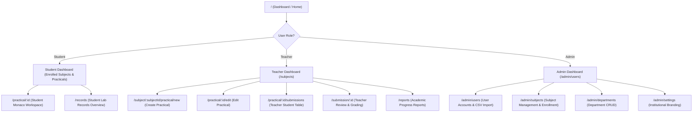

# LABORA — Frontend Architecture & Source Availability Audit

**Inspection Scope:** Frontend assets located in `server/frontend/` and Git history  
**Framework Detected:** React 18 (with React Router DOM, Monaco Editor, Tailwind CSS)  
**Build Tool Detected:** Vite  
**Asset Status:** **PRE-COMPILED DISTRIBUTION BUNDLE ONLY (`server/frontend/dist/`)**  

---

## 1. Critical Finding: Original React Source Code is Unavailable

> [!CAUTION]
> **Primary Architectural Limitation:** The original uncompiled React source code (`src/`, `package.json`, `vite.config.ts`, `.jsx`/`.tsx` files) **does NOT exist in this workspace or anywhere in the Git repository's history**.
>
> **Git History Evidence:**
> - Inspection of all Git commits (`git log --all --full-history -- "*.tsx" "*.jsx" "package.json"`) confirms that no frontend source files were ever committed to the repository. The baseline commit `403276f` contained only the pre-compiled assets in `server/frontend/dist/`.
> - In commit `c5ab27a` (*"feat(frontend): integrate asynchronous execution flow and polling in React workspace"*), the engineer **directly patched the minified and bundled JavaScript file** [server/frontend/dist/assets/index-DRq-BgX-.js](file:///d:/v/LABORA-Test-Windows/server/frontend/dist/assets/index-DRq-BgX-.js) to insert the asynchronous execution dispatch and polling loop.

---

## 2. Compiled Bundle Inventory & Structure

The compiled frontend is served from [server/frontend/dist](file:///d:/v/LABORA-Test-Windows/server/frontend/dist):

```text
server/frontend/dist/
├── index.html                           # Single-page application root (mounts #root)
├── favicon.svg                          # Terminal/beaker icon
├── icons.svg                            # SVG sprite for UI icons
└── assets/
    ├── index-DRq-BgX-.js                # Main application bundle (1,152,804 bytes)
    ├── index-BM31NznF.css               # Bundled Tailwind CSS styles (35,932 bytes)
    ├── editor.worker-CRz__AKW.js        # Monaco Editor core background worker (163,892 bytes)
    ├── cpp-C7h46wYY.js                  # Monaco C/C++ language syntax worker (15,285 bytes)
    ├── java-BEtHBSE6.js                 # Monaco Java language syntax worker (12,410 bytes)
    └── python-BGouXFzX.js               # Monaco Python language syntax worker (14,242 bytes)
```

---

## 3. Frontend Routing & Page Hierarchy

Analysis of the minified bundle reveals the complete React Router routing table:



### Full Route Inventory:
1. `/`: Home entry point. Displays subject cards and practicals for students; redirects teachers to `/subjects` and admins to `/admin/users`.
2. `/records`: Displays student's approved practicals grouped by subject, with one-click download buttons for full subject records (`.docx` / `.pdf`).
3. `/practical/:id`: Restricted student Monaco editor workspace.
4. `/subject/:subjectId/practical/new`: Teacher form for creating a new practical (experiment number, title, aim, question, language, starter code, sample input, restriction toggles).
5. `/practical/:id/edit`: Teacher form for editing an existing practical.
6. `/practical/:id/submissions`: Real-time teacher monitoring dashboard showing all enrolled students, completion status, run counts, and suspicious activity indicators.
7. `/submission/:id`: In-depth teacher review page. Displays student code, version history comparison, activity event timeline, execution logs, AI summary generator, and approval/correction controls.
8. `/reports`: Teacher/Admin course analytics showing submission counts, approvals, and anomaly rates.
9. `/admin/users`: User management table with role filtering and CSV import modal.
10. `/admin/subjects`: Course creation and student enrollment management.
11. `/admin/departments`: Department CRUD operations.
12. `/admin/settings`: College name, address, logo upload, and the `students_secure_browser_only` toggle.

---

## 4. API Client & Authentication Handling

### API Client (`Zn` helper function in bundle):
- Wrapped around native `fetch()`.
- Prepends `/api` base path.
- Automatically reads the JWT access token from `localStorage.getItem("token")` and attaches the `Authorization: Bearer <token>` header to all outgoing requests.
- Handles 401 Unauthorized by attempting a token refresh via `/api/auth/refresh/` using `localStorage.getItem("refresh")`. If refresh fails, it clears credentials and redirects to the login screen.
- Automatically parses JSON responses and catches API validation errors.

---

## 5. Monaco Editor Workspace Implementation

Located inside the student workspace component in `index-DRq-BgX-.js`:

### Features:
1. **Language Syntax Highlighting & Workers:**
   - Dynamically loads language workers based on practical language (`cpp`, `java`, or `python`).
   - Configures tab sizes (4 spaces), monospace font, and auto-closing brackets.
2. **Autosave Debouncing:**
   - Listens to Monaco model change events (`onDidChangeModelContent`).
   - Debounces saves to `POST /api/workspace/<id>/save/` every 10–15 seconds of typing.
3. **Execution & Non-Blocking Polling Loop (Commit `c5ab27a`):**
   ```javascript
   // Decompiled from index-DRq-BgX-.js line 930
   let r = await Zn(t + 'run-async/', { method: 'POST', body: { code: x.current, stdin: o } });
   if (r && r.execution_id) {
       l({ status: 'Queued', state: r.state || 'QUEUED', stdout: '[LABORA] Code queued in Celery worker...' });
       let tries = 0;
       while (tries < 60) {
           await new Promise(res => setTimeout(res, 1000));
           tries++;
           try {
               let s = await Zn('/executions/' + r.execution_id + '/');
               if (s) {
                   if (s.is_complete || ['COMPLETED', 'FAILED', 'TIMED_OUT', 'CANCELLED'].includes(s.state)) {
                       e = s; break;
                   } else {
                       l(s);
                   }
               }
           } catch(pollErr) { console.warn('Polling error:', pollErr); }
       }
       if (!e) throw new Error('Execution timed out waiting for runner.');
   }
   ```
4. **Synchronous Fallback:**
   - If `run-async/` throws an exception (e.g., Celery/Redis down), the catch block falls back to synchronous `POST /api/workspace/<id>/run/`.
5. **Restricted Mode & Activity Telemetry Batching:**
   - In restricted practicals (`restricted=True`), a fullscreen modal prompts the student: *"Start restricted session"*.
   - In the Secure Browser, requests the browser to enter fullscreen.
   - Blocks external copy/paste events in the browser DOM, capturing blocked paste attempts as `ActivityEvent(kind="paste_blocked")`.
   - Internal copying (within the Monaco editor) is allowed and recorded as `internal_paste`.
   - Window blur/focus events are intercepted and sent to `POST /api/workspace/<id>/events/`.
6. **Submission Flow:**
   - Student clicks "Submit".
   - Prompts confirmation dialog: *"Submit Experiment X? Your program and its last output will be locked and sent to your teacher."*
   - Sends `POST /api/workspace/<id>/submit/` with `{ code: editorCode }`.
   - Upon success, locks editor (`readOnly: true`).

---

## 6. Frontend Recovery & Reconstruction Recommendations

Because the original React source is missing, the following two paths exist for future development:

### Option A: Reconstruct Clean React Source (Recommended)
Because the backend REST API is clean, strictly typed, and fully documented in this audit report, the best long-term engineering path is to initialize a clean React + TypeScript + Vite project (`frontend/`):
1. Scaffold: `npm create vite@latest frontend -- --template react-ts`.
2. Install: `@monaco-editor/react`, `react-router-dom`, `lucide-react`, `tailwindcss`.
3. Re-implement the ~10 pages based on the API contracts in `07_API_DOCUMENTATION.md`.
4. This eliminates technical debt from reverse-engineering minified JavaScript and guarantees long-term maintainability.

### Option B: Deminification / AST Decompilation (Fallback)
If exact visual styling and layout replication must be extracted directly:
1. Format `server/frontend/dist/assets/index-DRq-BgX-.js` using `prettier`.
2. Extract the JSX template structures and component state hooks.
3. However, variable names and comments have been stripped by Vite/esbuild.
