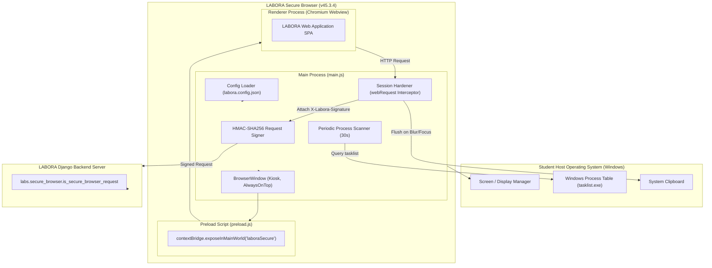

# LABORA — Electron Secure Browser Technical & Security Audit

**Inspection Scope:** Electron application files in `Secure Browser/`  
**Electron Runtime Version:** `45.3.4` (reported in `Secure Browser/version`)  
**Package Version:** `1.0.0` (from `Secure Browser/resources/app/package.json`)  
**Architecture:** Electron Main Process (`main.js`) + Preload Bridge (`preload.js`) + Packaged Chromium Webview  

---

## 1. Client Architecture & File Overview



---

## 2. Configuration & Runtime Architecture

Located in [Secure Browser/resources/app/main.js](file:///d:/v/LABORA-Test-Windows/Secure%20Browser/resources/app/main.js) and [Secure Browser/labora.config.json](file:///d:/v/LABORA-Test-Windows/Secure%20Browser/labora.config.json):

### Configuration Loading Hierarchy:
`main.js` checks the following locations in order:
1. Environment variable `LABORA_CONFIG`
2. `labora.config.json` next to the executable (`process.execPath`)
3. `labora.config.json` in `process.resourcesPath`
4. `labora.config.json` bundled in `__dirname`
Environment overrides:
- `LABORA_URL`: Overrides `serverUrl`.
- `LABORA_SECURE_BROWSER_KEY`: Overrides `browserKey`.

### Configuration Defaults in `labora.config.json`:
- `serverUrl`: `"http://127.0.0.1:8000"`
- `browserKey`: `"change-this-shared-browser-key"`
- `clearClipboardOnBlur`: `true`
- `processCheckSeconds`: `30`
- `blockedProcesses`: Array of 32 application names (e.g., `chatgpt`, `copilot`, `cursor`, `chrome`, `code`, `teams`, `discord`, `zoom`, `notepad++`, etc.).

---

## 3. Security Implementation Details

### 3.1 Sandboxing & Context Isolation (`BrowserWindow`)
In `main.js` (`createWindow()`):
- `contextIsolation: true`: Isolates preload script from renderer's window context.
- `nodeIntegration: false`: Renderer has zero access to Node.js `fs`, `child_process`, or `require`.
- `sandbox: true`: Standard Chromium process sandboxing enabled.
- `devTools: DEV`: DevTools disabled unless launched with `--dev` or `LABORA_DEV=1`.
- `navigateOnDragDrop: false`: Prevents dropping URLs or files into the window to navigate.
- `setContentProtection(true)`: Enables OS-level screen capture protection (blanks window during screen recording or remote desktop).

### 3.2 Navigation & External Request Restrictions
In `main.js` (`hardenSession()`):
- `ses.webRequest.onBeforeRequest`: Cancels any network request whose origin is not in `ALLOWED_ORIGINS` (only the LABORA server URL, `blob:`, `data:`, and local `offline.html` are permitted).
- `setPermissionRequestHandler`: Rejects all HTML5 permissions (clipboard-read, geolocation, webcam, microphone, notifications) except `fullscreen`.
- `setWindowOpenHandler`: Cancels popups (`window.open`). Links within the allowed origin navigate the main window; external links are dropped.
- `will-navigate`, `will-redirect`, `will-attach-webview`: All blocked if destination URL is external.

### 3.3 Keyboard & OS Shortcut Interception
- Global OS Shortcuts: Registers `CommandOrControl+R`, `F5`, `F11`, `F12`, `CommandOrControl+Shift+I`, `CommandOrControl+W`, `CommandOrControl+Q` via Electron `globalShortcut.register` to swallow escape keys.
- DOM Input Event Interceptor (`before-input-event`): Swallows `Alt+F4`, `Ctrl+W`, `Ctrl+Q`, `Ctrl+N`, `Ctrl+T`, `Ctrl+P`, `Ctrl+S`, `Ctrl+U`, `Ctrl+Shift+I/J/C`.

### 3.4 Clipboard & Multi-Display Defense
- `clearClipboard()`: Invokes Electron `clipboard.clear()` on startup, window blur, window focus, and before quit.
- Display Monitoring: `screen.on('display-added')` and `checkDisplays()` trigger a `labora:alert` if `screen.getAllDisplays().length > 1`.
- Process Monitoring: Every 30 seconds, executes `tasklist /fo csv /nh` (Windows) and compares running executable names against `blockedProcesses`. Matching processes trigger a `labora:alert` to the frontend, which logs an `ActivityEvent(kind="secure_alert")` for the teacher.

---

## 4. Cryptographic Attestation Protocol (HMAC-SHA256)

Every API request dispatched by the Secure Browser is intercepted by `ses.webRequest.onBeforeSendHeaders`:

```javascript
// main.js line 72
function sign(method, url) {
    const u = new URL(url)
    const ts = Math.floor(Date.now() / 1000).toString()
    const msg = `${ts}\n${method.toUpperCase()}\n${u.pathname}${u.search}`
    const sig = crypto.createHmac('sha256', config.browserKey || '').update(msg).digest('hex')
    return { ts, sig }
}
```

The interceptor attaches three HTTP headers:
1. `User-Agent`: Appends `LaboraSecureBrowser/1.0.0`
2. `X-Labora-Ts`: Current Unix timestamp in seconds
3. `X-Labora-Signature`: Hexadecimal HMAC-SHA256 hash of `ts\nMETHOD\n/path?query`
4. `X-Labora-Client`: `secure-browser/1.0.0`

### Backend Validation ([labs/secure_browser.py](file:///d:/v/LABORA-Test-Windows/server/backend/labs/secure_browser.py)):
- Validates that `abs(now - ts) <= 300` seconds (5 minutes clock skew allowance).
- Re-computes expected HMAC using `settings.SECURE_BROWSER_KEY`.
- Compares signatures using constant-time `hmac.compare_digest()`.

---

## 5. Security Vulnerability Assessment & Bypasses

### 5.1 Cleartext Secret Key Extraction (Severity: HIGH)
- **Vulnerability:** The shared secret key (`"change-this-shared-browser-key"`) is stored in cleartext inside `Secure Browser/labora.config.json` next to the executable.
- **Impact:** Any student with read access to the local workstation filesystem can open `labora.config.json` in Notepad, extract the key, and write a simple Python script or browser extension to compute valid HMAC signatures. This completely defeats the Secure Browser requirement from unauthorized external browsers.
- **Remediation:** 
  1. For collegiate lab PCs, deploy the Secure Browser to a directory write-protected from student accounts (`C:\Program Files\LABORA\`).
  2. Implement an asymmetric client attestation protocol (e.g., TPM-backed device certificates or Windows Hardware Attestation) rather than a shared static symmetric key.

### 5.2 Developer Mode Command-Line Bypass (Severity: HIGH)
- **Vulnerability:** In `main.js`:
  ```javascript
  const DEV = process.argv.includes('--dev') || process.env.LABORA_DEV === '1'
  ```
  When launched with `--dev`, the browser:
  - Disables kiosk mode (`kiosk: !DEV`)
  - Disables fullscreen (`fullscreen: !DEV`)
  - Disables `alwaysOnTop` (`alwaysOnTop: !DEV`)
  - Enables window closing (`closable: DEV`)
  - Enables Chromium DevTools (`devTools: DEV`)
  - Disables keyboard shortcut blocking (`if (DEV) return;`)
- **Impact:** Any student who launches the browser via `3 - SECURE BROWSER (windowed test mode).bat` or runs `LABORA Secure Browser.exe --dev` in PowerShell gains full access to DevTools, allowing arbitrary DOM manipulation, JavaScript inspection, network inspection, and uninhibited window multitasking.
- **Remediation:** Strip `--dev` flag handling and `LABORA_DEV` environment checks from all production release builds.

### 5.3 Process Detection Spoofing (Severity: MEDIUM)
- **Vulnerability:** Process checking uses `tasklist /fo csv /nh` and matches base executable names against a static list (`blockedProcesses`).
- **Impact:** If a student renames `chrome.exe` to `calculator.exe` or `svchost.exe`, the process check does not detect it. Furthermore, Electron's `sendAlert()` only notifies the teacher if a process starts; it does not terminate the unauthorized program.
- **Remediation:** Enforce Windows AppLocker or group policy kiosk configurations at the OS level on institutional lab computers.
