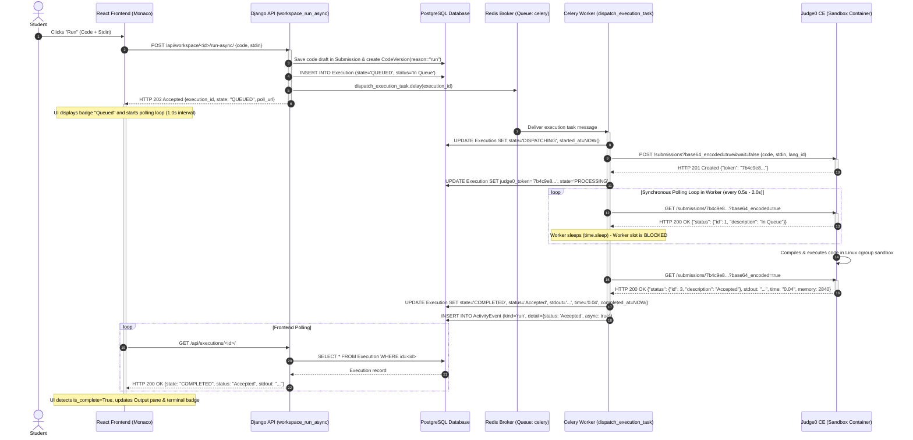

# LABORA — Code Execution Infrastructure & Celery Architecture Audit

**Inspection Scope:** Complete code execution pipeline across `server/backend/labs/`  
**Execution Subsystems:** Celery Task Queue, Redis Broker, Judge0 CE REST API, Local Host Runner  
**Key Source Files:** [labs/tasks.py](file:///d:/v/LABORA-Test-Windows/server/backend/labs/tasks.py), [labs/executor.py](file:///d:/v/LABORA-Test-Windows/server/backend/labs/executor.py), [labs/views.py](file:///d:/v/LABORA-Test-Windows/server/backend/labs/views.py), [labora/celery.py](file:///d:/v/LABORA-Test-Windows/server/backend/labora/celery.py), [labora/settings.py](file:///d:/v/LABORA-Test-Windows/server/backend/labora/settings.py)  

---

## 1. End-to-End Execution Sequence Diagram



---

## 2. Technical Component Specifications

### 2.1 Language Support & Compilation Handling
From [server/backend/labora/settings.py](file:///d:/v/LABORA-Test-Windows/server/backend/labora/settings.py#L131-L136) and [labs/executor.py](file:///d:/v/LABORA-Test-Windows/server/backend/labs/executor.py):

| Language | Judge0 Language ID | Local Mode Compiler / Command | Compilation & Execution Handling | Verified Status |
|---|---|---|---|---|
| **Python** | `71` (Python 3.8.1) | `python -I main.py` | Interpreted directly with standard library isolation (`-I`). | **Verified** |
| **C** | `50` (GCC 9.2.0) | `gcc main.c -o main.exe -lm` | Two-stage: 1) GCC compiles with 30s timeout; compile errors captured cleanly from `stderr`. 2) Executable run with stdin and 5s CPU limit. | **Verified** |
| **Java** | `62` (OpenJDK 13.0.1) | `javac Main.java` -> `java -cp . Main` | Two-stage: 1) Javac compiles with 60s timeout; compile errors captured. 2) Java runtime executes with memory and timeout limits. | **Verified** |

### 2.2 Execution States & Status Values
- **`Execution.State` Choices (Database State Machine):**
  - `QUEUED`: Enqueued in Celery / waiting in Redis.
  - `DISPATCHING`: Worker picked up task and is preparing HTTP request to Judge0.
  - `SUBMITTED_TO_RUNNER`: Awaiting acceptance from Judge0.
  - `PROCESSING`: Code is compiling or executing in Judge0 sandbox.
  - `COMPLETED`: Execution finished (whether exit code was 0 or non-zero).
  - `FAILED`: System error (runner unreachable, network drop, database error).
  - `TIMED_OUT`: Overall sandbox execution or polling wait exceeded threshold.
  - `CANCELLED`: User or admin aborted execution.
- **`Execution.status` Choices (Mirrors Judge0 Description):**
  - `"In Queue"`
  - `"Accepted"` (Clean exit code 0)
  - `"Compilation Error"` (Syntax error, GCC/Javac failure)
  - `"Time Limit Exceeded"` (CPU timeout)
  - `"Memory Limit Exceeded"` (RAM ceiling hit)
  - `"Runtime Error (NZEC)"` (Non-zero exit code / exception)
  - `"System Error"` (Runner network failure)

---

## 3. Critical Architectural Questions Answered

### 1. Does the Celery task block a worker while polling Judge0?
**YES (Architectural Defect).**
- **Evidence:** In [server/backend/labs/tasks.py](file:///d:/v/LABORA-Test-Windows/server/backend/labs/tasks.py#L122-L166):
  ```python
  while time.time() - start_time < max_wait_seconds:
      status_resp = requests.get(poll_url, headers=headers, timeout=5)
      ...
      time.sleep(poll_interval)
      poll_interval = min(poll_interval * 1.25, 2.0)
  ```
- **Consequence:** The Celery worker thread/process does not yield or release its concurrency slot while waiting for Judge0 to complete compilation and execution. In the production Docker Compose setup (`--concurrency=8`), **just 8 simultaneous executions will saturate 100% of the worker slots**. A 9th student who clicks "Run" will be queued behind the 8 blocked workers. Under 1,000 active students, the entire execution system will gridlock.

### 2. Are submission and result polling separate tasks?
**NO.**
- **Evidence:** `dispatch_execution_task` in `labs/tasks.py` performs both the initial HTTP POST to submit code and the subsequent `while` polling loop within the single Celery task execution.
- **Required Architecture:** Submission and result polling should be decoupled. The submission task should fire-and-forget to Judge0 with a webhook callback (`callback_url`), or schedule short-lived, self-rescheduling polling tasks (e.g., using Celery chord/eta or Redis countdowns).

### 3. What happens if Redis becomes unavailable?
- In `workspace_run_async` ([labs/views.py](file:///d:/v/LABORA-Test-Windows/server/backend/labs/views.py#L248)), `dispatch_execution_task.delay(ex.id)` is invoked without a `try...except` block catching Redis connection errors (`redis.exceptions.ConnectionError`).
- **Consequence:** The student receives an unhandled HTTP 500 Internal Server Error.
- **Data Inconsistency:** The `Submission` code was already saved, and an `Execution` record was created with `state="QUEUED"`. If Redis fails on `.delay()`, this `QUEUED` record remains permanently orphaned in the database.

### 4. What happens if a Celery worker crashes?
- If a worker process is killed (`SIGKILL`, OOM killer, host crash) while polling Judge0:
  - The `Execution` record remains permanently stuck in `DISPATCHING` or `PROCESSING`.
  - The student's frontend polls for 60 seconds, hits the frontend limit, and displays: `"Execution timed out waiting for runner."`
  - There is no background reaper task, Celery beat cron, or dead-letter processor to reconcile orphaned records.

### 5. What happens if Judge0 accepts a submission but the response is lost?
- If the HTTP POST to `/submissions?wait=false` succeeds on Judge0, but the network connection drops before Django receives the HTTP 201 response with the token:
  - An exception is caught in `tasks.py`: `ex.retry_count += 1; raise self.retry(exc=exc)`.
  - Celery retries the task from the beginning, issuing a **second HTTP POST** to Judge0.
  - This leaves the first job running on Judge0 as an untracked orphan.

### 6. Can duplicate Judge0 submissions occur?
**YES.**
- If a student triggers multiple clicks before the button disables, or if the task retries after a network drop, multiple Judge0 submissions are dispatched.
- Additionally, if the frontend's async request times out or catches an error, the frontend catch block in `index-DRq-BgX-.js` automatically falls back to synchronous `POST /api/workspace/<id>/run/`, launching a duplicate execution on Judge0 while the background task is still running.

### 7. Can an execution remain permanently queued?
**YES.**
- If Celery workers are down or saturated, an execution created with `state="QUEUED"` in `workspace_run_async` will sit in PostgreSQL and Redis indefinitely. The database schema does not define TTL or auto-expiry for stale queued records.

### 8. Are execution states updated consistently?
**Partially.**
- Normal async flow: `QUEUED` -> `DISPATCHING` -> `PROCESSING` -> `COMPLETED`.
- Synchronous flow (`workspace_run`): Directly creates `Execution(state=COMPLETED)`, completely bypassing intermediate states.
- Error flow: `FAILED` or `TIMED_OUT` is set properly if an exception is caught in the worker task.

### 9. Are failed executions recorded?
**YES.**
- In `tasks.py` lines 86-93, if `run_local` raises an exception, `ex.state = Execution.State.FAILED`, `ex.status = "System Error"`, and `ex.last_error = str(err)`.
- If Judge0 polling exceeds `max_wait_seconds`, `ex.state = Execution.State.TIMED_OUT` and `ex.status = "Time Limit Exceeded"`. Both call `ex.save()`.

### 10. Can students access another student's execution?
**NO (Enforced & Tested).**
- In [labs/views.py](file:///d:/v/LABORA-Test-Windows/server/backend/labs/views.py#L263-L272) (`execution_detail`):
  ```python
  if u.is_student:
      if ex.submission.student_id != u.id:
          raise PermissionDenied("You can only view your own executions.")
  ```
- This isolation is verified by automated test `test_async_execution_flow` in `labs/tests.py`.

### 11. Are Judge0 tokens exposed through API responses?
**YES (Security Information Leak).**
- In [server/backend/labs/serializers.py](file:///d:/v/LABORA-Test-Windows/server/backend/labs/serializers.py#L28-L34):
  ```python
  class ExecutionSerializer(serializers.ModelSerializer):
      class Meta:
          model = Execution
          fields = [
              "id", "stdin", "stdout", "stderr", "compile_output", "status", "state",
              "is_complete", "time", "memory", "judge0_token", "last_error",
              "started_at", "completed_at", "created_at"
          ]
  ```
- The internal `judge0_token` is included directly in the serialized API response. If Judge0 is exposed or reachable via internal network routing, a student can inspect network tabs, extract the token, and poll or manipulate Judge0 directly.

### 12. Can untrusted code execute on the Django host?
**YES, when `CODE_EXECUTOR=local`.**
- In local mode, `run_local()` uses `subprocess.run([sys.executable, "-I", path])`, `gcc`, or `javac/java` directly on the host machine. The subprocess runs with the full OS permissions of the Django server process. Any student can execute `import os; os.system("...")` in Python to read server files, delete directories, or open reverse shells.
- In `judge0` mode, code executes inside isolated Docker containers with Linux cgroups.

### 13. Is the local execution mode restricted to development?
**NO (Dangerous Configuration Risk).**
- There is **no guard** in `labora/settings.py` checking `if not settings.DEBUG and CODE_EXECUTOR == "local": raise ImproperlyConfigured(...)`.
- If `CODE_EXECUTOR=local` is defined in the production `.env` or Docker environment, Django will execute untrusted student code locally on the production server without warning.
