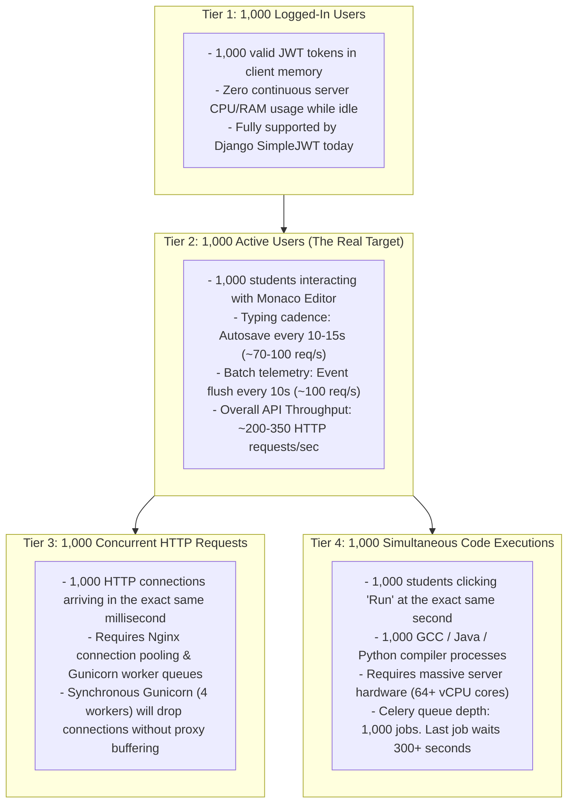

# LABORA — Performance & Scalability Audit: 1,000-User Capacity Model

**Target Objective:** Approximately 1,000 Concurrent Active Users (Collegiate Exam Environment)  
**Hardware Strategy:** ₹0 Cloud Cost (Self-hosted on College On-Premises Server)  
**Load Testing Blueprint:** [production_kit/load_testing/locustfile.py](file:///d:/v/LABORA-Test-Windows/production_kit/load_testing/locustfile.py)  
**Audit Verification Status:** **`UNVERIFIED / BLOCKED IN LOCAL AUDIT ENVIRONMENT`**  

---

## 1. Rigorous Conceptual Distinctions in Concurrency

To prevent architectural misunderstandings during college deployment, four distinct concurrency tiers must be strictly separated:

---

## 2. Component-by-Component Capacity Analysis

### 2.1 Django & Gunicorn Request Handling
- **Current Production Configuration:** 4 sync Gunicorn workers (`--workers 4` in `Dockerfile.backend`).
- **Capacity Analysis:** A synchronous Gunicorn worker processes one request at a time.
  - Typical web request (autosave or event batch) takes ~15–30ms.
  - Throughput per worker: ~30–60 requests/sec.
  - 4 workers provide a theoretical maximum throughput of **~120–240 req/sec**.
- **Bottleneck:** Under 1,000 active students generating 200–350 req/sec, 4 Gunicorn workers will operate near 100% saturation. If any slow query occurs (e.g., teacher dashboard N+1), workers will queue and Nginx will return `504 Gateway Timeout`.
- **Recommendation:** Increase Gunicorn workers to `8–12` (or transition to Uvicorn/ASGI or gevent workers) behind Nginx keepalive connection pools (`keepalive 32;` already configured in `nginx.conf`).

### 2.2 Database Connection & Write Frequency
- **Write Frequency at 1,000 Students:**
  - Autosaves: Every student saving every 15s generates **~67 database transactions/sec**. Each save issues an `UPDATE Submission` and an `INSERT INTO CodeVersion`.
  - Activity Telemetry: Ingested in batches of up to 500 events. ~100 batch requests/sec issue `ActivityEvent.objects.bulk_create()`.
  - Total write volume: **~150–200 SQL write operations/sec**.
- **Capacity Analysis:** PostgreSQL 16 on modern NVMe SSD storage easily handles 1,000–3,000 writes/sec if properly indexed. However, PostgreSQL's default `max_connections` is 100.
- **Bottleneck:** If Gunicorn workers, Celery workers, and Judge0 all connect to PostgreSQL directly without PgBouncer, connection pool exhaustion (`FATAL: remaining connection slots are reserved for non-superuser connections`) will occur.
- **Recommendation:** Deploy PgBouncer in front of PostgreSQL with a connection pool size of 80.

### 2.3 Celery Worker Concurrency vs. Blocking Judge0 Polling
- **Current Production Configuration:** `celery -A labora worker --concurrency=8` in `docker-compose.prod.yml`.
- **Capacity Analysis:**
  - As audited in `06_CODE_EXECUTION_AND_CELERY.md`, each Celery worker process executes a `while` sleep-poll loop waiting for Judge0 to compile and run code.
  - Average execution time (compilation + execution + poll latency): ~2.5 seconds.
  - With 8 worker slots, the maximum execution throughput is:
    $$\text{Throughput} = \frac{8 \text{ workers}}{2.5 \text{ seconds}} = 3.2 \text{ executions/sec}$$
- **The Queue Bottleneck under Exam Load:**
  - In a 1,000-student lab exam, suppose 20% of students click "Run" within a 1-minute window (200 executions).
  - Time to clear 200 jobs at 3.2 jobs/sec:
    $$\text{Clearance Time} = \frac{200}{3.2} = 62.5 \text{ seconds}$$
  - The 200th student in line will wait **over 62 seconds** before their job finishes.
  - Because the frontend polling loop in `index-DRq-BgX-.js` times out at **60 seconds**, the student's browser will abort and display: `"Execution timed out waiting for runner."`
- **Recommendation:**
  1. Decouple Celery task from polling (use Judge0 webhook callbacks).
  2. Increase Celery concurrency from 8 to 32+ across multiple worker processes.

### 2.4 Document Generation Workload (PDF & DOCX)
- **Current Implementation:** Synchronous in `_file_response()` ([labs/views.py](file:///d:/v/LABORA-Test-Windows/server/backend/labs/views.py#L380)).
- **Capacity Analysis:** DOCX generation takes ~50ms. WeasyPrint PDF compilation of an 8-page practical record with embedded HTML and CSS takes **~1.5 to 3.0 seconds** of intensive CPU rendering.
- **Bottleneck:** If 50 students simultaneously click "Download Lab Record" at the conclusion of an exam, 4 Gunicorn workers will be completely tied up rendering WeasyPrint PDFs, causing all other API endpoints to stall.
- **Recommendation:** Offload PDF generation to background Celery workers, storing the completed PDF in media storage and notifying the client when ready for download.

---

## 3. Progressive Load-Testing Staged Strategy

When testing on actual college hardware, the load test must not be executed at 1,000 users immediately. It must follow the staged ramp-up below using [production_kit/load_testing/locustfile.py](file:///d:/v/LABORA-Test-Windows/production_kit/load_testing/locustfile.py):

| Test Stage | Simulated Users | User Ramp Rate | Expected Web RPS | Expected Execution RPS | P95 Web Latency Target | Acceptance Criteria |
|---|---|---|---|---|---|---|
| **Stage 1** | **50** | 5 users/sec | ~15–25 req/s | ~1–2 runs/s | < 250 ms | 0% HTTP 5xx errors; 0 queued executions |
| **Stage 2** | **100** | 10 users/sec | ~30–50 req/s | ~2–4 runs/s | < 350 ms | Celery queue depth < 5; memory stable |
| **Stage 3** | **250** | 25 users/sec | ~75–125 req/s | ~5–8 runs/s | < 500 ms | P95 execution turnaround < 5.0s |
| **Stage 4** | **500** | 50 users/sec | ~150–250 req/s | ~10–15 runs/s | < 800 ms | CPU utilization < 75%; no Redis dropped connections |
| **Stage 5** | **750** | 50 users/sec | ~225–375 req/s | ~15–25 runs/s | < 1,200 ms | P95 execution turnaround < 8.0s |
| **Stage 6** | **1,000** | 50 users/sec | ~300–500 req/s | ~20–35 runs/s | < 1,500 ms | Error rate < 0.1%; zero worker starvation crashes |

---

## 4. Minimum Server Hardware Sizing for 1,000 Concurrent Students

Based on the compute requirements of Judge0 sandboxing and concurrent Django/Gunicorn workers:

| Hardware Component | Minimum College Specification (Single Host) | Recommended High-Reliability Specification (Dual Host) |
|---|---|---|
| **CPU Architecture** | 32 Physical Cores (AMD EPYC or Intel Xeon) | Host 1 (Web/DB/Redis): 16 Cores; Host 2 (Judge0 Sandbox Pool): 32 Cores |
| **RAM (Memory)** | 64 GB DDR4/DDR5 ECC RAM | Host 1: 32 GB RAM; Host 2: 64 GB RAM |
| **Disk Storage** | 1 TB Enterprise NVMe SSD (PCIe Gen4) | 1 TB NVMe SSD on each node (RAID 1 mirrored) |
| **Network Interface** | 1 Gbps Full-Duplex Ethernet | 10 Gbps Inter-node link + 1 Gbps Campus LAN uplink |
