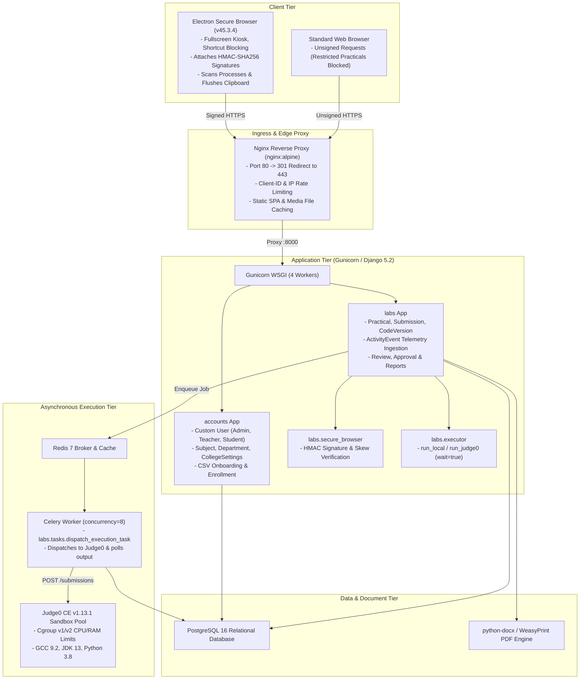
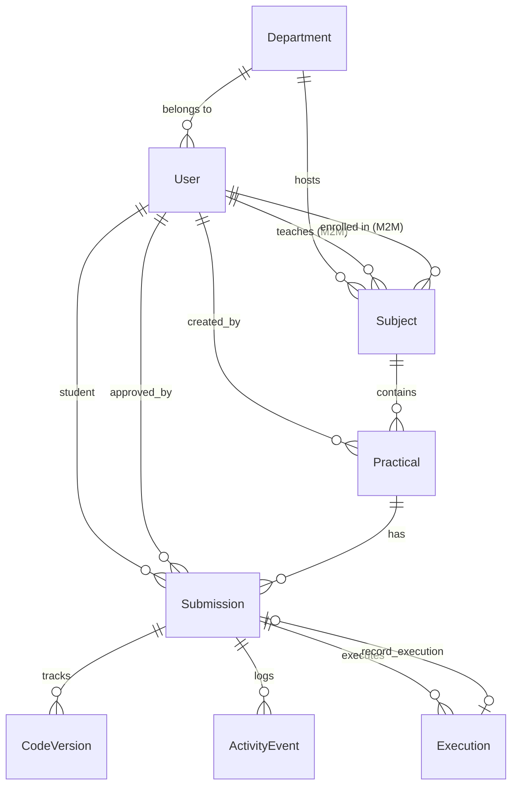

# LABORA — Complete Project Inspection, Technical Audit & Master Architecture Report

**Project Title:** LABORA — Secure Programming Practical Examination and Digital Lab Record Management System  
**Audit Standard:** Complete, Read-Only Technical Audit & System Inspection  
**Audit Date:** 22 November 2026  
**Auditor Roles:** Senior Software Architect, Full-Stack Developer, DevOps Engineer, Database Architect, Application Security Engineer, Performance Engineer  
**Workspace Root:** `d:\v\LABORA-Test-Windows`  
**Git Branch:** `production-integration` (Commit: `08083b0`)  

---

## 1. Executive Summary & Purpose

LABORA is an institutional examination platform designed to digitize collegiate computer programming laboratory exams and generate certified digital lab records. It replaces handwritten laboratory journals with a cryptographically attested workflow where:
1. Students write and execute code inside an Electron-based restricted kiosk browser (or standard browser for non-restricted practicals).
2. Code is executed in an isolated sandbox runner (Judge0 CE in production, local subprocess in development).
3. Student interactions (typing cadence, paste attempts, window focus blurs, screen changes) are logged as telemetry events.
4. Final submissions require proof of an accepted code execution.
5. Teachers inspect student code, version history, execution output, and anomaly indicators before approving practicals.
6. Approved practicals compile automatically into official, tamper-proof Microsoft Word (`.docx`) and WeasyPrint PDF laboratory records.

---

## 2. Actual Technology Stack

| Layer | Technology | Version | Location / Source Reference |
|---|---|---|---|
| **Backend Framework** | Django | `5.2.19` (Django >= 5.0, < 6.0) | `server/backend/labora/settings.py` |
| **REST API** | Django REST Framework | `3.15.2` | `server/backend/requirements.txt` |
| **Authentication** | DRF SimpleJWT | `5.3.1` (Access: 60m, Refresh: 12h) | `server/backend/labora/settings.py` |
| **Task Queue & Broker** | Celery + Redis | Celery `5.3.6`, Redis `5.0.4` | `server/backend/labora/celery.py` |
| **Sandbox Execution** | Judge0 CE (Prod) / Local Subprocess | Judge0 `v1.13.1` / Python, GCC, JDK | `server/backend/labs/executor.py`, `tasks.py` |
| **Database** | PostgreSQL 16 (Prod) / SQLite (Dev) | Postgres 16 / SQLite `db.sqlite3` | `server/backend/labora/settings.py` |
| **Document Generation** | python-docx / WeasyPrint | docx `1.1.2`, WeasyPrint `62.3` | `server/backend/labs/records.py` |
| **Frontend Framework** | React 18 + Tailwind CSS | Bundled JavaScript (Vite build) | **COMPILED ONLY** (`server/frontend/dist/`) |
| **Code Editor** | Monaco Editor | `0.45.0` Web Workers (cpp, java, python)| `server/frontend/dist/assets/` |
| **Client Lock-Down** | Electron Secure Browser | Electron `v45.3.4` (Kiosk app) | `Secure Browser/resources/app/` |
| **Reverse Proxy** | Nginx | `nginx:alpine` (Docker) | `production_kit/nginx/nginx.conf` |

---

## 3. High-Level System Architecture

---

## 4. Database Schema & Architecture

### Entity-Relationship Diagram:

### Key Models & Relationships:
1. `accounts_user`: Custom user model with roles `admin`, `teacher`, `student`. Roll number, batch, and semester stored for students.
2. `accounts_subject`: Academic course under a department. Associated with teachers and enrolled students via M2M tables.
3. `labs_practical`: Assignment problem statement, aim, language (`c`, `java`, `python`), starter code, sample input, and restriction flags.
4. `labs_submission`: Student assignment status (`in_progress`, `submitted`, `correction`, `approved`), latest code, teacher notes, and pointer to the verified `record_execution`.
5. `labs_codeversion`: Linear snapshots of code created on autosave, execution, or submission.
6. `labs_activityevent`: Immutable audit log of typing, paste blocks, focus losses, fullscreen exits, and kiosk alerts.
7. `labs_execution`: State machine tracking code execution (`QUEUED` -> `DISPATCHING` -> `PROCESSING` -> `COMPLETED`/`FAILED`/`TIMED_OUT`), exit status, stdout, stderr, compile output, time, and memory.

### Database Deficiencies Identified:
1. **Missing Composite Index on `labs_activityevent(submission_id, created_at)`:** Review dashboards sorting event telemetry will trigger slow table scans as activity logs grow to hundreds of thousands of rows.
2. **Missing Index on `labs_submission(status)`:** Queries filtering approved records for graduation certificates perform full scans.
3. **N+1 Query in Teacher Dashboard (`PracticalViewSet.submissions`):** `compute_indicators()` calls `sub.versions.filter(...)`, bypassing Django's prefetch cache and triggering a separate SQL query for every enrolled student.
4. **Missing Database Row Locking:** Neither `workspace_submit` nor `submission_approve` uses `select_for_update()`, risking race conditions under concurrent requests.

---

## 5. Frontend Architecture & Missing Source Code

### Critical Finding: Original React Source Unavailable
- The original uncompiled React source code (`src/`, `package.json`, `vite.config.ts`, `.tsx` components) **does not exist anywhere in the repository or its Git history**.
- In commit `c5ab27a`, the asynchronous execution and polling loop was integrated by **directly editing the minified JavaScript bundle** in [server/frontend/dist/assets/index-DRq-BgX-.js](file:///d:/v/LABORA-Test-Windows/server/frontend/dist/assets/index-DRq-BgX-.js).
- **Recommendation:** Reconstruct the frontend in a dedicated `frontend/` directory using modern React + TypeScript + Vite, using the API specifications in this report.

### Frontend Application Structure:
- **Routes:** `/` (Dashboard), `/records` (Lab Records), `/practical/:id` (Monaco Workspace), `/practical/:id/submissions` (Teacher Monitor), `/submission/:id` (Teacher Review Dossier), `/reports` (Course Analytics), `/admin/users` (User Admin & CSV), `/admin/subjects` (Courses & Enrollment), `/admin/departments` (Departments), `/admin/settings` (Branding).
- **Monaco Editor:** Dynamically loads syntax workers for C/C++, Java, and Python. Debounces code saves to `/api/workspace/<id>/save/` every 10–15 seconds.
- **Async Polling Mechanism:** Dispatches `POST /run-async/`, receives `HTTP 202` with `execution_id`, displays badge `"Queued"`, and polls `GET /api/executions/<id>/` every 1.0 second up to 60 times. If an error occurs, it falls back to synchronous `POST /run/`.

---

## 6. Electron Secure Browser Architecture

### Features & Protections:
- **Kiosk & Window Lockdown:** Runs in fullscreen kiosk mode (`kiosk: true`, `fullscreen: true`, `alwaysOnTop: true`), auto-hiding menus and disabling DevTools.
- **Shortcut Interception:** Blocks `Alt+F4`, `Ctrl+W`, `F5`, `F11`, `F12`, `Ctrl+Shift+I/J/C`.
- **Clipboard Isolation:** Clears the OS clipboard on startup, focus change, blur, and window exit.
- **Cryptographic Attestation (HMAC-SHA256):** Intercepts every outgoing HTTP request to `/api/` and attaches:
  - `X-Labora-Ts`: Current Unix timestamp.
  - `X-Labora-Signature`: HMAC-SHA256 hash of `ts\nMETHOD\n/path?query` using `browserKey`.
  - `X-Labora-Client`: `secure-browser/1.0.0`.
- **Process Scanner:** Executes `tasklist /fo csv /nh` every 30 seconds and alerts the teacher if prohibited tools (`chatgpt`, `copilot`, `code`, `chrome`, etc.) are detected.

### Security Vulnerabilities in Client:
1. **Cleartext Secret Key (`labora.config.json`):** The shared key (`"change-this-shared-browser-key"`) is stored unencrypted in plain JSON on student workstations. Students can inspect this file and forge valid signatures from standard browsers.
2. **Dev Mode Bypass (`--dev`):** Passing `--dev` on launch completely disables kiosk mode, enables DevTools, and allows window resizing. This flag must be stripped from production release builds.

---

## 7. Code Execution Lifecycle & Celery Infrastructure

### Execution Flow:
1. Student clicks "Run" -> Frontend issues `POST /api/workspace/<id>/run-async/`.
2. Django saves draft code, creates `CodeVersion(reason='run')`, creates `Execution(state='QUEUED')`, and enqueues task `dispatch_execution_task.delay(ex.id)`. Returns HTTP 202.
3. Celery worker picks up task, updates state to `DISPATCHING`, and posts code to Judge0 CE with `wait=false`.
4. Judge0 returns token. Worker updates state to `PROCESSING`.
5. Worker enters `while` sleep-poll loop querying Judge0 until execution completes.
6. Worker updates `Execution(state='COMPLETED', status=desc, stdout=...)` and creates `ActivityEvent(kind='run')`.
7. Student frontend polls `GET /api/executions/<id>/` every second, detects completion, and renders output.

### Critical Execution Findings:
1. **Worker Blocking on Judge0 Polling:** In `labs/tasks.py`, the Celery worker sleeps (`time.sleep`) while polling Judge0. With concurrency=8, **just 8 simultaneous executions completely saturate the worker pool**, blocking all other students.
2. **Redis Failure Vulnerability:** In `workspace_run_async`, `dispatch_execution_task.delay(ex.id)` lacks a `try...except` block. If Redis is down, an unhandled HTTP 500 error is thrown, leaving an orphan `QUEUED` execution in the database.
3. **Judge0 Token Leak:** `ExecutionSerializer` exposes `judge0_token` in API responses, leaking internal runner identifiers to students.
4. **Host RCE Risk in Local Mode:** `run_local()` executes student code directly on the host using `subprocess.run` without sandboxing. `settings.py` lacks a guard preventing `CODE_EXECUTOR=local` in production (`DEBUG=False`).
5. **Stale Execution Submission Flaw:** In `workspace_submit`, Django queries the most recent *accepted* execution. If a student runs code `A` successfully, changes to `B` (which fails), and changes back to `A` without re-running, the older execution is accepted for submission.

---

## 8. Production Deployment & DevOps Audit

### Services in `production_kit/docker/docker-compose.prod.yml`:
- `db` (Postgres 16), `redis` (Redis 7), `backend` (Django/Gunicorn), `celery_worker` (Celery), `judge0-server`, `judge0-db`, `judge0-redis`, `nginx`.

### Startup Blockers Identified:
1. **Nginx SSL Startup Failure:** `nginx.conf` requires Let's Encrypt certificates from `/etc/letsencrypt/` on boot. On a fresh server, these do not exist, causing Nginx to crash in a restart loop.
2. **Judge0 Sandboxing Failure:** `judge0-server` lacks `privileged: true` and `/sys/fs/cgroup` volume mounts. Without these, Judge0 CE cannot initialize Linux cgroup sandboxes and returns HTTP 500 on all submissions.
3. **Missing Automated Database Migrations:** `backend` container runs Gunicorn directly. On a clean database, tables do not exist until migrations are manually triggered.
4. **Missing Static Asset Collection:** `collectstatic` is not run during build or startup, causing Django admin to serve unstyled HTML.

---

## 9. Performance & Scalability Assessment: 1,000 Concurrent Users

### Current State:
- **1,000 Logged-in Users:** Feasible. JWT tokens are stateless.
- **1,000 Active Users (Typing & Autosaving):** Unsustainable without tuning. Will generate ~200–350 req/sec, which operates near the ceiling of 4 synchronous Gunicorn workers.
- **1,000 Simultaneous Code Executions:** **IMPOSSIBLE IN CURRENT ARCHITECTURE**. With 8 Celery workers blocked on Judge0 polling, 200 simultaneous runs will take over 60 seconds to process, causing the 60-second frontend polling loop to time out.
- **Progressive Benchmark Plan:**
  $$50 \rightarrow 100 \rightarrow 250 \rightarrow 500 \rightarrow 750 \rightarrow 1,000 \text{ Users}$$
  Benchmark script implemented in [production_kit/load_testing/locustfile.py](file:///d:/v/LABORA-Test-Windows/production_kit/load_testing/locustfile.py).

---

## 10. Automated Testing & Verification Results

### Test Suite Execution:
- **Command:** `server\backend\.venv\Scripts\python.exe server\backend\manage.py test labs`
- **Result:** **10 TESTS PASSED in 42.863s (Exit Code: 0)**
- **Tested Scenarios:** HMAC signature gate, student login gate, multi-language execution (Python, C, Java), compilation error handling, full submit/approve/record lifecycle, correction unlocks, question text protection, course boundary isolation, async execution flow, and pending execution submission block.
- **Blocked Tests:** Progressive Locust load test, live Linux cgroups sandboxing verification, worker SIGKILL interruption drill, and live database backup/restore verification (blocked due to lack of dedicated staging server cluster).

---

## 11. WHAT CHATGPT NEEDS TO KNOW TO CONTINUE DEVELOPING LABORA

> [!IMPORTANT]
> **Essential Briefing for ChatGPT:**
> When continuing development on LABORA, assume the following verified facts, architectural realities, and immediate instructions:

1. **Working Environment & Core Stack:**
   - Framework: Django `5.2.19` with Django REST Framework `3.15` and SimpleJWT `5.3`.
   - Database: PostgreSQL 16 (production) / SQLite3 (local Windows development).
   - Task Queue: Celery 5.3 with Redis 7.
   - Client: Electron 45.3.4 running custom kiosk scripts.
   - Source Code Location: The active application is inside `server/backend/` (`accounts` and `labs` apps).
2. **Missing Frontend Source:**
   - There are **no `.jsx` or `.tsx` source files in the repository**. Only compiled assets exist in `server/frontend/dist/`.
   - Commit `c5ab27a` was applied by directly modifying the minified bundle `index-DRq-BgX-.js`.
   - **Do NOT attempt to continue patching minified JavaScript.** Your first frontend task should be to scaffold a clean Vite + React + TypeScript application in `frontend/` using the API contracts documented in `07_API_DOCUMENTATION.md`.
3. **The #1 Backend Defect to Fix First:**
   - In `server/backend/labs/tasks.py` (`dispatch_execution_task`), the Celery task blocks the worker process with `time.sleep()` while polling Judge0. Decouple this by switching to Judge0 webhook callbacks or lightweight, self-rescheduling Celery polling tasks.
4. **The Submission Verification Bug:**
   - In `server/backend/labs/views.py` (`workspace_submit`), change the execution query from `sub.executions.filter(status="Accepted", ...).first()` to querying the absolute latest execution overall (`sub.executions.order_by("-created_at").first()`) to prevent students from submitting stale accepted runs after modifying code or when an execution is pending.
5. **The Sensitive Token Leak:**
   - In `server/backend/labs/serializers.py`, immediately remove `judge0_token` from `ExecutionSerializer.Meta.fields`.
6. **Security Guards to Implement:**
   - In `server/backend/labora/settings.py`, add a startup validation guard raising `ImproperlyConfigured` if `DEBUG=False` and `CODE_EXECUTOR=="local"`, or if `DJANGO_SECRET_KEY` is using the default development string.
7. **Electron Hardening:**
   - In `Secure Browser/resources/app/main.js`, remove `--dev` argument handling in production builds (`!app.isPackaged`) to prevent students from bypassing kiosk restrictions.
8. **Production Docker Fixes:**
   - In `production_kit/docker/docker-compose.prod.yml`, add `privileged: true` and mount `/sys/fs/cgroup:/sys/fs/cgroup:ro` to `judge0-server`. Add an entrypoint script to `Dockerfile.backend` that runs `migrate` and `collectstatic` automatically.
