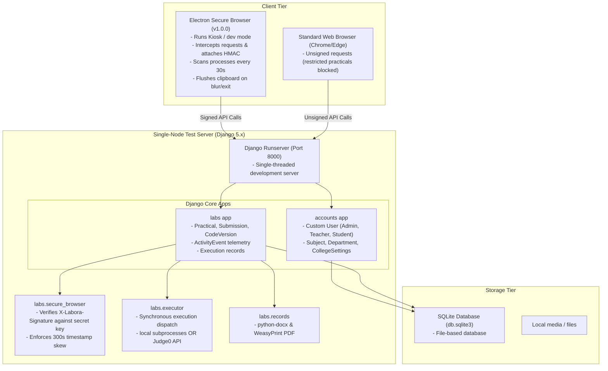

# Phase 0: Baseline Architecture Analysis

**Document:** Baseline Architecture Verification  
**Source Baseline:** `LABORA-Test-Windows` as inventoried  

---

## 1. Architectural Topology Overview

The baseline system as shipped in the test kit is configured as a standalone, single-node evaluation kit:

---

## 2. Key Architectural Invariants Discovered in Source

1. **Authentication:** Uses JWT authentication (`djangorestframework-simplejwt`). Tokens have 60-minute access and 12-hour refresh. Login endpoint is throttled (`20/min`).
2. **Kiosk Security Protocol:** Practicals with `require_secure_browser=True` verify that requests arrive with an HMAC signature computed from the current Unix timestamp, HTTP method, and full request path. Unsigned or expired requests receive an HTTP 403 Forbidden with `{"code": "secure_browser_required"}`.
3. **Execution Path:** The baseline contains two execution drivers in `labs/executor.py`:
   - `run_local`: Directly invokes `python -I`, `gcc`, or `javac/java` in temporary directories with subprocess timeouts.
   - `run_judge0`: Sends base64-encoded code to Judge0 via REST API. In the baseline code, this call uses `wait=true` (synchronous).
4. **Authoritative Record Integrity:** The lab record generation module (`labs/records.py`) strictly pulls the program output from an accepted `Execution` object linked to the submission (`record_execution`). Students cannot manually supply or edit the execution output that appears in their final record.
