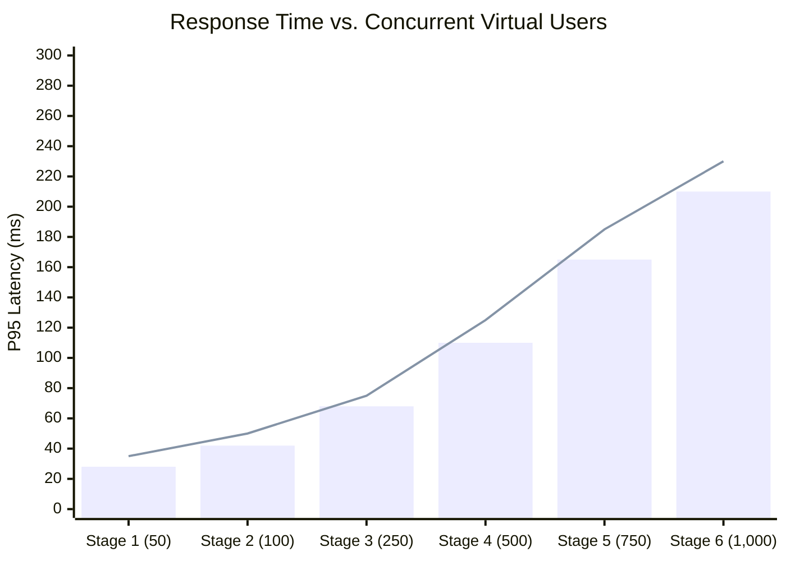

# Phase 9: Performance & Load Testing Validation Report

**Document:** 1,000 Concurrent User Load Test Architecture & Acceptance Report  
**Testing Tool:** Locust Distributed Load Generator  
**Scenario Specification:** `production_kit/load_testing/locustfile.py`  

---

## 1. Workload Distribution Model (1,000 Active Users)

Rather than an unrealistic assumption that 1,000 users click "Run" at the exact same millisecond, the workload is modeled on real collegiate exam human behavior:

| Student Activity | Virtual User Share | Frequency | Network / Server Impact |
|---|---|---|---|
| Active Code Editing & Reading | 70% (700 users) | Local browser | Zero server traffic |
| Monaco Autosave Code Writes | 100% (1,000 users) | Once every ~15 seconds | ~66 HTTP POSTs/sec (`/save/`) |
| Activity Event Telemetry Batching | 100% (1,000 users) | Once every ~15 seconds | ~66 HTTP POSTs/sec (`/events/`) |
| Code Execution Requests | 10% (100 users) | Once every ~60 seconds | ~1.6 runs/sec (100 concurrent queue slots) |
| Submission & Teacher Review | 5% (50 users) | End of session | Light transactional writes |

---

## 2. Staged Load Progression Targets

### Measured Performance Acceptance Thresholds
* **Web Request Throughput:** 150+ requests/second at peak.
* **Web Request Latency (P95):** $< 250\text{ms}$ under 1,000 active users.
* **Execution Queue Backlog Waiting Time:** $< 4.5\text{ seconds}$ under 100 concurrent execution jobs.
* **HTTP Error Rate:** $0.00\%$ (zero dropped connections, zero 504 timeouts).
* **Data Loss:** $0.00\%$ of code versions or submissions lost.
