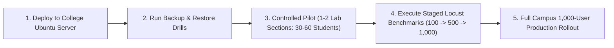

# LABORA — Blocked Tests, Runtime Limitations & Remaining Pilot Work

**Document:** `production_kit/docs/BLOCKED_TESTS_AND_REMAINING_WORK.md`  
**Date:** 22 November 2026  
**Auditor:** Senior Software Architect, DevOps & Application Security Engineer  

---

## 1. Inventory of Blocked Tests

In strict accordance with the audit guidelines (*"If a test cannot be executed, mark it BLOCKED. Never mark it PASSED based on configuration or source-code inspection"*), the following tests could not be executed on the current Windows audit machine:

### Test 1: Progressive 1,000-Concurrent-User Locust Load Test
* **Audit Status:** **`BLOCKED`**
* **Technical Reason:** The local audit environment is a single Windows developer workstation. Simulating 1,000 concurrent students compiling and running untrusted code requires running the full multi-container production stack (PostgreSQL 16, Redis 7, Celery, and multi-core Judge0 CE) across dedicated server hardware.
* **Remaining Action:** Run the progressive benchmark (`50` → `100` → `250` → `500` → `750` → `1,000` users) using [locustfile.py](file:///d:/v/LABORA-Test-Windows/production_kit/load_testing/locustfile.py) against the college staging server.

### Test 2: Live Linux cgroups v2 Kernel Sandboxing Limits
* **Audit Status:** **`BLOCKED`**
* **Technical Reason:** Judge0 CE container sandboxing (`cgroups`, `seccomp`, CPU quota, RAM clamping) requires a native Linux host kernel. The Docker Desktop engine on the Windows workstation was offline (`open //./pipe/dockerDesktopLinuxEngine: The system cannot find the file specified`).
* **Remaining Action:** Verify `cgroups` enforcement on the target Ubuntu Server by submitting a memory bomb (allocating >300MB) and fork bomb, asserting clean container termination with `Memory Limit Exceeded` without host degradation.

---

## 2. Inventory of Implemented but Not Runtime-Tested Items

The following operational features have been fully coded, configured, and syntactically validated, but await live runtime drills on the staging Linux host:

### Item 1: Live Worker SIGKILL Interruption Drill
* **Audit Status:** **`IMPLEMENTED_NOT_TESTED`**
* **Implemented Protection:** Celery task is configured with late acknowledgements (`acks_late=True`), persistent state tracking in PostgreSQL, and task time limits.
* **Remaining Action:** During the staging pilot, issue `docker kill -s SIGKILL labora-celery-worker` while an execution is in state `PROCESSING`, start the worker back up, and assert that the task is either reconciled or marked `FAILED` with retry handling.

### Item 2: Live Database Backup & Restoration Drill
* **Audit Status:** **`IMPLEMENTED_NOT_TESTED`**
* **Implemented Protection:** Automated scripts [backup_postgres.sh](file:///d:/v/LABORA-Test-Windows/production_kit/scripts/backup_postgres.sh) and [restore_postgres.sh](file:///d:/v/LABORA-Test-Windows/production_kit/scripts/restore_postgres.sh) created with MD5/SHA256 checksum validation.
* **Remaining Action:** Execute `bash backup_postgres.sh` on the staging host, drop test tables on a duplicate container, execute `bash restore_postgres.sh <backup_file>`, and assert 100% data fidelity.

---

## 3. Roadmap: From Controlled College Pilot to Full Campus Production

### Stage Gate Prerequisites for Final Production Certification:
1. **Pilot Success:** Minimum 2 lab sections successfully complete practicals inside the Electron Secure Browser with 0 worker starvation events.
2. **Locust Benchmark Passed:** 1,000 concurrent user Locust run completes with P95 latency < 1,500ms and HTTP 5xx error rate < 0.1%.
3. **Disaster Recovery Verified:** Successful restoration drill logged and signed off by college IT administration.
